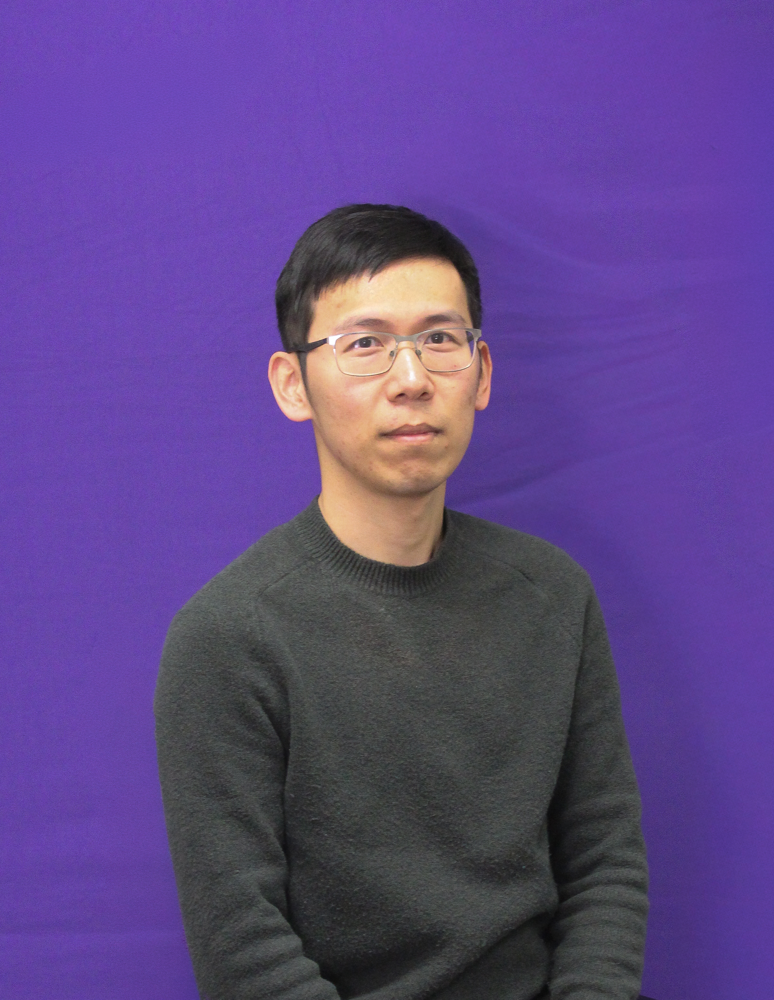



<!-- Person 1 -->

  
  

    <h3>Jessica Grembi</h3>
    <h4 style="margin-top: -10px; color: gray;">PI</h4>
    
 Guojun is a 1st year tenure track Assistant Professor at K-State. Find her CV <a href="https://jgrembi.github.io/files/JA_Grembi_CV.pdf">here</a>.

  

